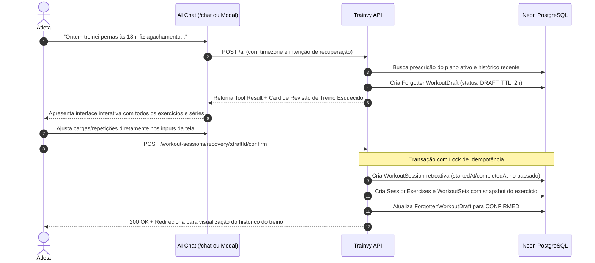

# Task 6.5B — Design Arquitetural: Recuperação de Treinos Esquecidos (Forgotten Workout Recovery)

## 1. Visão Geral e Escopo

No Trainvy, a **Task 6.5** foi estruturada em duas fases ontologicamente distintas:
- **Task 6.5A (Em Execução):** Assistente de IA ativo durante a sessão em andamento (`/workout-sessions/[sessionId]`), auxiliando em dúvidas de execução, progressão de carga e geração de propostas contextuais e editáveis de séries com confirmação explícita do atleta.
- **Task 6.5B (Planejada):** Assistente conversacional pós-fato para **recuperação de treinos esquecidos** (ex: *"Ontem treinei Peito e Tríceps na academia do condomínio sem celular, fiz 4 séries de Supino com 80kg e 3 de Tríceps Corda..."*).
- **Escopos Posteriores:** Reconhecimento de voz (STT/TTS em tempo real) e modelos locais on-device ficam reservados para etapas futuras do roadmap.

Este documento estabelece as especificações arquiteturais, de concorrência, integridade temporal e segurança para a implementação da Task 6.5B.

---

## 2. Princípios e Guardrails Arquiteturais

1. **A IA Nunca Grava Diretamente no Banco:**
   Assim como na Task 6.5A, nenhuma mensagem de chat ou invocação de tool pode inserir diretamente `WorkoutSession`, `SessionExercise` ou `WorkoutSet`. A IA produz um **Rascunho de Recuperação de Treino** (`ForgottenWorkoutDraft`), que deve ser apresentado em uma tela dedicada para revisão completa do atleta antes de qualquer gravação transacional.
2. **Imutabilidade de Sessões Concluídas:**
   A recuperação de treinos passados **nunca pode alterar, sobrescrever ou mesclar** dados em sessões de treino já finalizadas (`completedAt !== null`). Caso o atleta tente registrar um treino em uma data/horário que colida com uma sessão existente, o sistema deve alertar o conflito e exigir decisão explícita.
3. **Consistência de Timezone e Datas Passadas:**
   Toda interpretação de data relativa (*"ontem"*, *"segunda-feira passada"*, *"anteontem às 19h"*) deve ser computada no fuso horário IANA do atleta (ex: `America/Sao_Paulo`), nunca no fuso UTC do servidor. Sessões no futuro são estritamente rejeitadas.
4. **Limite Temporal de Recuperação (Window Threshold):**
   A recuperação retroativa é permitida para treinos realizados nos últimos **7 dias** (máximo configurável de 30 dias para assinantes Pro/Coach). Datas anteriores a esse limite exigem inserção manual assistida ou aprovação do Personal.

---

## 3. Modelo de Dados Proposto

```prisma
enum ForgottenWorkoutDraftStatus {
  DRAFT
  CONFIRMED
  DISCARDED
  EXPIRED
}

model ForgottenWorkoutDraft {
  id                      String                      @id @default(uuid())
  userId                  String
  user                    User                        @relation(fields: [userId], references: [id], onDelete: Cascade)
  
  targetDate              DateTime                    @db.Date
  startedAt               DateTime                    @db.Timestamptz()
  completedAt             DateTime                    @db.Timestamptz()
  
  workoutPlanId           String?
  workoutPlan             WorkoutPlan?                @relation(fields: [workoutPlanId], references: [id], onDelete: SetNull)
  workoutDayId            String?
  workoutDay              WorkoutDay?                 @relation(fields: [workoutDayId], references: [id], onDelete: SetNull)
  
  title                   String                      // Ex: "Treino A - Peitoral e Tríceps (Recuperado)"
  origin                  WorkoutSessionOrigin        // PLANNED ou FREE
  
  status                  ForgottenWorkoutDraftStatus @default(DRAFT)
  proposedExercises       Json                        // Array estruturado de exercícios e séries
  confirmedSessionId      String?                     // Vínculo após confirmação com WorkoutSession criada
  
  idempotencyKey          String?                     @unique
  expiresAt               DateTime                    @db.Timestamptz()
  createdAt               DateTime                    @default(now()) @db.Timestamptz()
  updatedAt               DateTime                    @updatedAt @db.Timestamptz()

  @@index([userId, status])
  @@index([userId, targetDate])
}
```

### Estrutura do JSON `proposedExercises`:
```json
[
  {
    "order": 1,
    "exerciseId": "uuid-catalogo",
    "exerciseNameSnapshot": "Supino Reto com Barra",
    "sets": [
      {
        "order": 1,
        "type": "WARMUP",
        "weightKg": 40,
        "reps": 15,
        "rir": null
      },
      {
        "order": 2,
        "type": "WORKING",
        "weightKg": 80,
        "reps": 10,
        "rir": 2
      }
    ]
  }
]
```

---

## 4. Detecção de Duplicatas e Protocolo Anti-Colisão

Antes de confirmar a gravação de um treino recuperado:
1. **Busca por Colisão de Janela:**
   ```sql
   SELECT id, "startedAt", "completedAt"
   FROM "WorkoutSession"
   WHERE "athleteId" = $userId
     AND "completedAt" IS NOT NULL
     AND (
       ("startedAt", "completedAt") OVERLAPS ($startedAt, $completedAt)
       OR ("startedAt"::date = $targetDate AND "workoutDayId" = $workoutDayId)
     );
   ```
2. **Comportamento em Caso de Conflito:**
   - Se já existe uma sessão idêntica no mesmo dia/treino: retorna `HTTP 409 Conflict` (`DUPLICATE_WORKOUT_SESSION`), instruindo o atleta de que o treino já se encontra registrado no histórico.
   - O atleta pode optar por descartar o rascunho ou ajustar o horário/origem para treino livre complementar.

---

## 5. Fluxo de Execução e Interface do Atleta



---

## 6. Governança e Rastreabilidade

- Cada `WorkoutSession` gerada por recuperação retroativa deve conter a flag ou origin documentada no `notes` ou metadata (`recoveryDraftId`), garantindo rastreabilidade para o atleta e para o Personal Trainer.
- Em caso de Personal conectado (Task 6.3), a notificação de treino concluído retroativamente deve indicar claramente: *"Treino de ontem registrado retroativamente pelo aluno"*.
